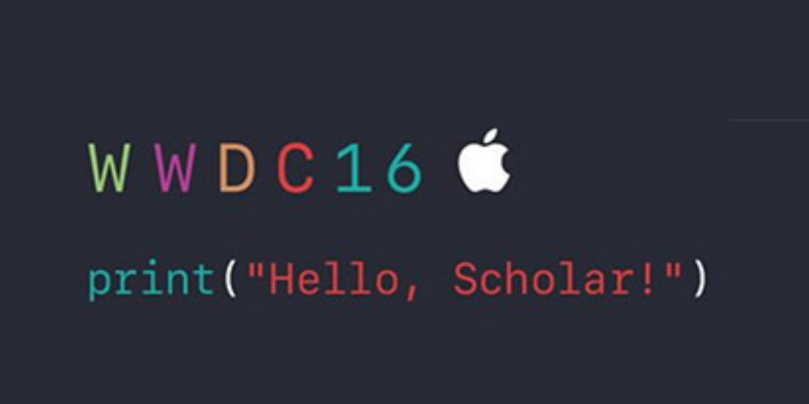

# WWDC 2016 - Scholarship

List of student submissions for the WWDC 2016 - Scholarship. The list is in alphabetical order.

### How to add your submission?
1. **[Click here to open the form](https://github.com/wwdc/2016/issues/new?template=submit.yml)** and fill it in.
2. Send it. A bot checks your entry within a minute and tells you if anything needs fixing. You can edit the form after sending.
3. When it is approved your entry appears on this list.

#### How to update or remove your submission?
Use the **[update form](https://github.com/wwdc/2016/issues/new?template=update.yml)**. Only the person who sent the entry can change it.

### Submissions

| Participant | Links  | Status            |
|:--|:--|:--|
| [Agisilaos Tsaraboulidis](https://twitter.com/AgisilaosTs) |  |  |
| [Ahan Malhotra](https://twitter.com/ahan_tm) | [App Store](https://itunes.apple.com/us/app/tedxcoconutgrove/id1078121660) CloudKit &amp; Maps |  |
| [Al Park](https://www.linkedin.com/in/alspark) | [App Store](https://itunes.apple.com/us/app/reax-witness-america-right/id1076183758) 3D Touch |  |
| [Alex Hoppen](https://twitter.com/ahoppen) | [GitHub](https://github.com/ahoppen/WWDC-Scholarship-2016) |  |
| [Alex Melnychuck](https://www.facebook.com/amelnychuck) | [App Store](https://itunes.apple.com/app/apple-store/id1020281972?mt=8) CareKit &amp; NSLinguisticTagger |  |
| [Alex Telek](https://twitter.com/alexmtk) |  |  |
| [Alexander Groß](https://www.facebook.com/iamag3) | [App Store](https://itunes.apple.com/ai/app/doyokno/id1016053500?mt=8) |  |
| [Alisson Selistre](https://br.linkedin.com/in/alissonselistre) | [Video](https://www.youtube.com/watch?v=R4MG_5iwtoE) |  |
| [Aman Jain](https://twitter.com/amanj203) | [App Store](https://itunes.apple.com/in/app/hurtle/id1085122455?mt=8) · [Video](https://www.youtube.com/watch?v=hpqBGLglLTs) SpriteKit &amp; 3D Touch |  |
| [Amit Kalra](https://twitter.com/amitnkalra) | [App Store](https://itunes.apple.com/us/app/6284-calc/id1006996600?mt=8) · [Video](https://www.youtube.com/watch?v=2JnI8qE-LKs) |  |
| Andreas Neusuess | [App Store](https://itunes.apple.com/app/id848979893) · [Video](https://youtu.be/7It2i-9BCp8) |  |
| [Andrew Ke](https://twitter.com/andrewke64) | [App Store](https://itunes.apple.com/us/app/formative/id1032617767?mt=8) Push Notifications &amp; 3D Touch |  |
| [Andrew Robinson](https://twitter.com/sirarkimedes) | [App Store](https://itunes.apple.com/us/app/brio-dont-fall!/id1087287522?mt=8) |  |
| [Antoine Cormery](https://twitter.com/legomanfish) | [GitHub](https://github.com/legomanfish/peereversi) MultipeerConnectivity |  |
| [Anushk Mittal](https://twitter.com/AnushkMittal) | [App Store](https://itunes.apple.com/us/app/sleepisle/id1039746876?mt=8) HealthKit &amp; 3D Touch |  |
| [Arik Sosman](https://twitter.com/arikaleph) | [Video](https://youtu.be/TtHM31sxxbU) |  |
| Arnav Gudibande | [GitHub](https://github.com/SFHSHacks/DriveSafe) · [Video](https://www.youtube.com/watch?v=4Ft6264U1PU) MapKit &amp; CoreLocation |  |
| [Aryan Kashyap](https://twitter.com/NSAryan12) | [Video](https://www.youtube.com/watch?v=qD-uxBhNKb4) |  |
| Aubert Charles | [App Store](https://geo.itunes.apple.com/fr/app/charlietranslater/id1033023882?mt=8) MapKit &amp; Scene/SpriteKit |  |
| [Ayuna Vogel](https://www.linkedin.com/in/ayunavogel) | [GitHub](https://github.com/ayunav/Neverlate) Geofences, Venmo API |  |
| [Ayush Aggarwal](https://twitter.com/Highestage) |  |  |
| [Benjamin Herzog](https://twitter.com/benchr) | [App Store](https://itunes.apple.com/de/app/lovoo-match/id1078169975?mt=8) tvOS &amp; UIKit |  |
| [Brendan Boyle](https://twitter.com/brendancboyle) | [App Store](https://itunes.apple.com/us/app/universal-presenter-remote/id866740670?ls=1&mt=8) watchOS 2 &amp; 3D Touch |  |
| [Cheng-Yu Hsu](https://twitter.com/cyhsutw) | [Source](http://hop.appfinca.com) |  |
| [Cristian Tabuyo](https://instagram.com/ctapple_swift) | [App Store](https://itunes.apple.com/es/app/alternativa-a-un-termometro/id1098259543?mt=8) |  |
| [Damian Camilleri](https://damiancamilleri.com/) | 3D Touch &amp; Collection Views |  |
| [Dean Eigenmann](https://twitter.com/parklyapp) | [Source](https://www.parkly.ch) |  |
| [Duan Wen](https://twitter.com/wddwycc) | [GitHub](https://github.com/wddwycc/Freehand) |  |
| [Eduardo Santi](https://br.linkedin.com/in/eduardo-santi-44a9a399) | [GitHub](https://github.com/santieduardo/WWDC16) 3D Touch &amp; MapKit |  |
| [Eli Yazdi](https://twitter.com/eli_yazdi) | [App Store](https://itunes.apple.com/us/app/3dtones/id1108446298?mt=8) |  |
| [Erik Sargent](https://twitter.com/esthepiking) | [App Store](https://itunes.apple.com/us/app/taxbot-automatic-mile-tracker/id461781884?mt=8) Core Location &amp; Core Motion |  |
| [Evan Dekhayser](https://twitter.com/ERDekhayser) | [App Store](https://itunes.apple.com/us/app/contact-archiver/id733594022?mt=8) |  |
| [Eytan Schulman](https://twitter.com/eytanschulman) | [App Store](https://itunes.apple.com/us/app/journey-creator/id1065269702?mt=8) MapKit &amp; 3D Touch |  |
| [Felipe Silva](https://twitter.com/felipedmsilva) | [App Store](https://itunes.apple.com/us/app/aliens-jelly/id1100376973?l=pt&ls=1&mt=8) Siri Remote &amp; SpriteKit |  |
| [Felix Knispel](https://twitter.com/felkni) | HomeKit |  |
| [Finn Gaida](https://twitter.com/fga) | [App Store](https://itunes.apple.com/us/app/customizable-keys-keyboard/id1104673201?mt=8) Live Photos &amp; UIVisualEffects |  |
| [Florian Pfisterer](https://twitter.com/FlorianPfi) | [App Store](https://itunes.apple.com/app/flowlog-find-your-flow-in/id1072346312) CoreAnimation &amp; Notifications |  |
| [George Turner](https://twitter.com/FlamingFusion) | Apple Watch &amp; Push Notifications |  |
| [Gustaf Rosenblad](https://twitter.com/rosecoder) | [App Store](https://itunes.apple.com/se/app/skolmaten/id416550379?mt=8) |  |
| [Hari](https://www.twitter.com/coderguy5) | Core Motion &amp; GLKit |  |
| [Harish Yerra](https://www.twitter.com/harishyerra4) | 3D Touch &amp; MapKit |  |
| [Henrique Valcanaia](https://twitter.com/henrique_iv) | [App Store](https://itunes.apple.com/br/app/rett-syndrome/id1043536159?mt=8) ResearchKit &amp; 3D Touch |  |
| [Hollis Liu](https://twitter.com/hollis0807) | [App Store](https://itunes.apple.com/us/app/spread-get-things-done/id1061507772?mt=8) 3D Touch &amp; HealthKit |  |
| [Jan Philip Bernius](https://github.com/jpbernius) | 3D Touch &amp; MapKit |  |
| Jari Martens | [App Store](https://itunes.apple.com/app/connectr-all-social-media/id905696962?mt=8) |  |
| [Jaxon Kneipp](http://www.jaxonkneipp.com/) | 3D Touch &amp; Apple Watch |  |
| [Jeremy Stucki](https://twitter.com/parklyapp) | [Source](https://www.parkly.ch) |  |
| [Jessica Yeh](https://twitter.com/JessicaYeh) | [App Store](https://itunes.apple.com/us/app/omnibuzz-location-alarm-for/id1076106050) MapKit &amp; Core Location |  |
| [Jimmy Liu](https://twitter.com/zuhayeer) | [App Store](https://itunes.apple.com/app/apple-store/id967147939?mt=8) |  |
| [John Ciocca](https://twitter.com/johnciocca) | CloudKit &amp; 3D Touch |  |
| [Josh Bruce](https://twitter.com/Brucey125) |  |  |
| [Kabir Oberai](https://twitter.com/kabiroberai) |  |  |
| [Kai Aldag](https://twitter.com/kaicode2) | 3D Touch &amp; Core Spotlight Search |  |
| [Kesi Maduka](https://twitter.com/k3zi_) | CoreAudio &amp; 3D Touch |  |
| [Kilian Koeltzsch](https://github.com/kiliankoe) | [Source](https://parkendd.de) MapKit &amp; 3D Touch |  |
| [Klemens Strasser](https://twitter.com/klemensstrasser) | [App Store](https://itunes.apple.com/us/app/elementary-minute/id889417668?mt=8) SpriteKit, UIKit, Accessibility, 3D Touch +1 |  |
| [Kyle Bashour](https://twitter.com/kylebshr) | [App Store](https://itunes.apple.com/app/id1050023116) |  |
| [Kyle Spadaro](https://twitter.com/kylespadaro) | [GitHub](https://github.com/kylespadaro/KyleSpadaro) WebKit &amp; UIKit |  |
| [Leonard Mehlig](https://twitter.com/leoMehlig) | [App Store](https://itunes.apple.com/de/app/jedox-social-analytics/id980605596) 3D Touch &amp; Maps |  |
| [Luqman Fauzi](https://twitter.com/lkmfz) | [App Store](https://itunes.apple.com/app/movfeedly/id1085496373) |  |
| [Marcel Voss](https://twitter.com/uimarcel) | [Video](https://www.youtube.com/watch?v=dZljrMjzJN0) |  |
| [Martijn de Vos](https://twitter.com/devos50) | [App Store](https://itunes.apple.com/us/app/newlinq/id950231000?l=nl&ls=1&mt=8) |  |
| [Maurice Breit](https://twitter.com/1mau6) | [App Store](https://itunes.apple.com/de/app/4fahrt-schuler/id1105478291?mt=8) |  |
| [Maximilian Litteral](https://twitter.com/MaxHasADHD) | [Source](http://maximilianlitteral.com/TelevisionTime/iTunes/index.html) CloudKit &amp; 3D Touch |  |
| [Michael Dugan](https://twitter.com/Michael_Dugan33) | MapKit &amp; 3D Touch |  |
| [Michael Royzen](https://twitter.com/MichaelRoyzen) | [App Store](https://itunes.apple.com/us/app/recipereadr-your-recipes-read/id963588160?ls=1&mt=8) AVSpeechSynthesizer &amp; 3D Touch |  |
| [Natanel Niazoff](https://twitter.com/niazoff) | [App Store](https://itunes.apple.com/us/app/zmanim-for-yu/id1071006216?mt=8) |  |
| [Nicholas Gibson](https://twitter.com/Mr_NickyG) | [App Store](https://itunes.apple.com/us/app/predsnu/id917520140?mt=8) |  |
| [Philippe Yu](https://twitter.com/philippeyu) | [GitHub](https://github.com/philippejlyu/Philippe-Yu-WWDC) CoreAnimation, AVFoundation |  |
| [Rehaan Advani](https://twitter.com/Rehaan_Advani) | [Video](https://www.youtube.com/watch?v=mUDBBcXHkLI) MapKit &amp; 3D Touch |  |
| [Ritvik Upadhyaya](http://pages.cs.wisc.edu/~ritvik/) | MultipeerConnectivity |  |
| [Saif Al-Dilaimi](https://twitter.com/SAIFG92) | [App Store](https://itunes.apple.com/us/app/pray-for-world-add-any-flag/id1075363176?mt=8) 3D Touch &amp; Push Notifications |  |
| [Salman Husain](https://twitter.com/aeroxtwo) | [GitHub](https://github.com/shusain93/Ettiquete) · [Video](https://www.youtube.com/watch?v=pjTiw9Mc19o) 3D Touch &amp; Accessibility |  |
| [Sam Eckert](https://twitter.com/Sam0711er) | [App Store](https://geo.itunes.apple.com/us/app/simple-counter-count-everything!/id961653412?mt=8) · [Video](https://www.youtube.com/watch?v=4uFP_xQWOX4) 3D Touch &amp; watchOS |  |
| [Sam Patzer](https://twitter.com/wizages) | [Video](https://www.youtube.com/watch?v=-DFINkoEZhU) |  |
| [Sebastian Dobrincu](https://twitter.com/sebyddd) | [App Store](https://itunes.apple.com/us/app/voya-your-personal-travel/id1082760606) · [Video](https://www.youtube.com/watch?v=fbTMWC0y9hs) |  |
| [Shashank Sharma](https://www.facebook.com/shashank135sharma) | HomeKit |  |
| [Shunzhe Ma](https://twitter.com/ShunzheMa) |  |  |
| [Siddhant Chaurasia](https://twitter.com/mr_s_chaurasia) | [App Store](https://itunes.apple.com/us/app/places-sst/id921357959?mt=8) |  |
| [Simon Christian Krüger](http://kayos.eu/) | [Source](https://appsto.re/de/vsYj7.i) HealthKit &amp; CoreAnimation |  |
| [Stephen McMillan](https://twitter.com/stevowevo77) | [App Store](https://itunes.apple.com/app/daily-riddle-fun-challenging/id932546719) WatchKit &amp; 3D Touch |  |
| [Stephen Melinyshyn](https://melinysh.me) | [GitHub](https://github.com/Melinysh/WWDC-Student-Scholarship-App-2016) UIDynamics &amp; 3D Touch |  |
| Tejen Patel | [GitHub](https://www.github.com/tejen/codepath-flicks/) |  |
| [Timur Galimov](https://www.facebook.com/timaktimaktimak) | [App Store](https://itunes.apple.com/us/app/adicty-awesome-dictionary/id979262617?mt=8) 3D Touch &amp; Spotlight Search |  |
| Tom Morrell | [Source](http://saker.io) ResearchKit &amp; 3D Touch |  |
| [Varun Shenoy](http://varunshenoy.github.io/) | [App Store](https://itunes.apple.com/us/app/summit-summarized-news-reader/id1106793298?mt=8) 3D Touch &amp; MapKit |  |
| [Vegard Solheim Theriault](https://twitter.com/vegather) | [GitHub](https://github.com/vegather/2048-Multiplayer) SpriteKit |  |
| Vignesh Varadarajan | [App Store](https://itunes.apple.com/us/app/brainychess-play-learn-chess/id778336641?mt=8) · [Video](https://www.youtube.com/watch?v=H429tmvM0zI) |  |
| [Vincent Le](https://www.instagram.com/vinnyoodles/) | [GitHub](https://github.com/QSport/QSport) · [Video](https://www.youtube.com/watch?v=f1vPOc-EaQ8) |  |
| [Vladimir Danila](https://twitter.com/danilavladi) | [App Store](https://itunes.apple.com/us/app/codinator/id1024671232?ls=1&mt=8) |  |
| [Weiran Xiong](https://twitter.com/WeiranXiong) |  |  |
| [Will Oakley](https://twitter.com/woakley5) | [App Store](https://itunes.apple.com/ie/app/coincident-3d-touch-game/id1069735902?mt=8) |  |
| [Yichen Cao](https://twitter.com/schemetrical) | [App Store](https://itunes.apple.com/us/app/pixel/id936267373?ls=1&mt=8) Keyboard Extension &amp; 3D Touch |  |
| [Yifei He](https://twitter.com/eflyjason) | [App Store](https://itunes.apple.com/us/app/gu-shi-yi-zhi-dan/id1030296579?l=zh&ls=1&mt=8) Apple Watch &amp; iBeacon |  |
| [Zach Simone](https://twitter.com/zachsimone) | [App Store](https://itunes.apple.com/au/app/daily-steps-simple-step-counting/id720629415?mt=8) Apple Watch &amp; 3D Touch |  |
| [Zuhayeer Musa](https://twitter.com/zuhayeer) | [App Store](https://itunes.apple.com/app/apple-store/id967147939?mt=8) |  |

##### Total: 96 | Awarded: 47
